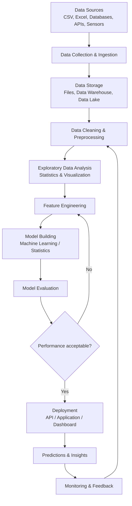

# 📊 Introduction to Data Science

Welcome! This README is a beginner-friendly introduction to **Data Science**. It explains what data science is, how a typical data science project works, which tools are commonly used, and where data science is applied.

## 📌 What Is Data Science?

**Data Science** is the field of using data, programming, mathematics, statistics, and domain knowledge to discover useful insights and support better decisions.

In simple words:

> Data Science turns raw data into meaningful information that can help solve real-world problems.

For example, an online shopping company can analyze customer purchases to understand what people like, recommend products, and predict future demand.

## 🎯 Why Is Data Science Important?

Organizations collect large amounts of data from websites, mobile apps, sensors, transactions, and many other sources. Data science helps them:

- Understand patterns and trends.
- Make decisions based on evidence.
- Predict possible future outcomes.
- Improve products and customer experiences.
- Detect unusual activity, errors, or fraud.
- Automate certain tasks using machine learning.

## 🔄 Data Science Lifecycle

A typical data science project follows these stages:

1. **Problem Understanding** – Define the question or problem to solve.
2. **Data Collection** – Gather relevant data from files, databases, APIs, sensors, or other sources.
3. **Data Cleaning** – Fix missing values, duplicates, incorrect formats, and inconsistent records.
4. **Exploratory Data Analysis (EDA)** – Explore the data using statistics and visualizations to find patterns.
5. **Feature Engineering** – Select, transform, or create useful input variables.
6. **Model Building** – Apply statistical methods or machine learning algorithms when prediction is needed.
7. **Model Evaluation** – Test how well the model performs on data it has not seen before.
8. **Deployment** – Make the model or analysis available to an application or its users.
9. **Monitoring** – Track performance and update the solution when data or requirements change.

## 🏗️ Data Science Architecture – Block Diagram

The following Mermaid flowchart shows a common high-level data science workflow, from collecting raw data to delivering insights or predictions.



### Architecture Explanation

| Component | Purpose |
|---|---|
| Data Sources | Provide raw data for analysis. |
| Data Collection | Brings data into the system. |
| Data Storage | Stores collected data for later use. |
| Cleaning & Preprocessing | Improves data quality and prepares it for analysis. |
| Exploratory Data Analysis | Helps understand distributions, relationships, and patterns. |
| Feature Engineering | Creates or selects useful variables for analysis or modeling. |
| Model Building | Trains a statistical or machine learning model. |
| Model Evaluation | Checks whether the model is reliable for the intended task. |
| Deployment | Makes the solution available to users or other systems. |
| Monitoring | Checks performance and identifies when updates are needed. |

*Note: Not every data science project needs machine learning or deployment. Some projects focus on analysis, reports, and dashboards.*

## 🧰 Tools and Technologies

| Area | Common Tools | What They Are Used For |
|---|---|---|
| Programming | Python, R | Writing code and analyzing data |
| Databases | SQL, MySQL, PostgreSQL | Retrieving and managing data |
| Data Analysis | Pandas, NumPy | Cleaning and manipulating data |
| Visualization | Matplotlib, Seaborn, Power BI, Tableau | Creating charts and dashboards |
| Machine Learning | Scikit-learn | Building predictive models |
| Deep Learning | TensorFlow, PyTorch | Training neural networks |
| Development | Jupyter Notebook, VS Code | Writing and running code |
| Big Data | Apache Spark | Processing large datasets |

## 🐍 Role of Python in Data Science

Python is one of the most widely used programming languages in data science because it is readable and has a large ecosystem of libraries.

Some important Python libraries:

- **NumPy** – Numerical calculations and arrays.
- **Pandas** – Working with tables and datasets.
- **Matplotlib** – Creating charts and graphs.
- **Seaborn** – Statistical data visualization.
- **Scikit-learn** – Traditional machine learning.
- **TensorFlow / PyTorch** – Deep learning.

Example:

```python
import pandas as pd

# Create a small dataset
data = {
    "Name": ["Amit", "Priya", "Rahul"],
    "Marks": [80, 90, 75]
}

df = pd.DataFrame(data)

# Display the dataset
print(df)

# Calculate average marks
print("Average Marks:", df["Marks"].mean())
```

## 🤖 Data Science, Machine Learning, and AI

These fields are related, but they are not identical:

- **Data Science:** Uses data to understand problems, discover insights, and support decisions.
- **Machine Learning (ML):** A branch of AI in which systems learn patterns from data to make predictions or decisions.
- **Artificial Intelligence (AI):** A broader field focused on creating systems that perform tasks associated with human intelligence.

A data science project may use machine learning, but not every data science project requires it.

## 🌍 Real-World Applications

1. **Healthcare** – Supporting medical research and analyzing patient data.
2. **Banking** – Detecting suspicious transactions and assessing risk.
3. **E-commerce** – Product recommendations and demand forecasting.
4. **Education** – Understanding student performance and learning patterns.
5. **Transportation** – Traffic analysis and route optimization.
6. **Agriculture** – Crop analysis and yield forecasting.
7. **Entertainment** – Recommending movies, music, and videos.

## 🗺️ Beginner Learning Roadmap

A practical order for learning data science:

1. Learn programming fundamentals (variables, data types, conditions, loops, functions).
2. Learn Python basics.
3. Learn mathematics and statistics fundamentals.
4. Learn NumPy and Pandas.
5. Practice data cleaning and exploratory data analysis.
6. Learn data visualization.
7. Learn SQL and database basics.
8. Study machine learning fundamentals.
9. Build small projects using real datasets.
10. Learn how to explain and present your results.

### Suggested Beginner Projects

- Student marks analysis.
- Sales data analysis.
- Weather data visualization.
- Movie recommendation system.
- House price prediction.

## 💼 Career Opportunities

Some roles related to this field include:

- Data Analyst
- Junior Data Scientist
- Business Intelligence Analyst
- Machine Learning Engineer
- Data Engineer
- AI/ML Engineer

The skills required differ by role. For example, data analyst roles often emphasize SQL, spreadsheets, visualization, and statistics, while machine learning roles generally require stronger programming and model-building skills.

## ✅ Conclusion

Data Science combines programming, mathematics, statistics, and problem-solving to extract value from data. Beginners should focus on programming fundamentals, Python, SQL, statistics, and practical projects before moving to advanced machine learning and deep learning.

**Keep learning, keep practicing, and build projects with real datasets!**

---

## 📚 Useful Learning Resources

- [Python Official Tutorial](https://docs.python.org/3/tutorial/)
- [Pandas Documentation](https://pandas.pydata.org/docs/)
- [NumPy Documentation](https://numpy.org/doc/)
- [Scikit-learn User Guide](https://scikit-learn.org/stable/user_guide.html)
- [Kaggle Learn](https://www.kaggle.com/learn)
- [SQLBolt – Learn SQL](https://sqlbolt.com/)
